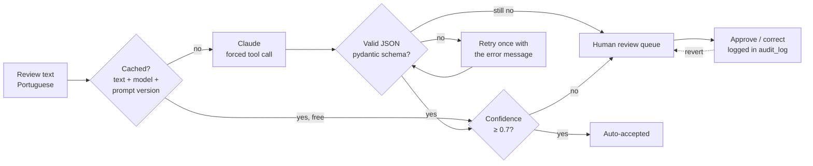

# Review Triage with LLMs


An automation that reads customer reviews written in **Portuguese** and turns each one into a structured, English-language ticket: what the problem is, whether someone needs to act, and a one-line summary. Uncertain cases go to a **human review queue**, every human decision is **logged and reversible**, and accuracy is **measured against a hand-labelled answer key**.

> Python · Claude API (tool use + pydantic validation) · SQLite · Streamlit · pytest

**Data:** 2,000 real reviews from Olist, a Brazilian online marketplace ([source](https://github.com/olist/work-at-olist-data), MIT licence).

---

## The problem

Support teams receive thousands of free-text reviews. Reading them all is slow; keyword rules are cheap but miss anything phrased differently. An LLM can read like a person, but in production it needs guardrails: a fixed output format, cost control, a way for humans to catch its mistakes, and proof that it is accurate.

## How it works



Each review becomes:

```json
{
  "sentiment": "negative",
  "topics": ["seller_service", "wrong_or_missing_item"],
  "needs_action": true,
  "summary_en": "Customer received the wrong voltage and got no reply to emails.",
  "confidence": 0.94
}
```

**Topics** (fixed taxonomy, shown to both the model and human reviewers): `not_received`, `late_delivery`, `wrong_or_missing_item`, `damaged_or_defective`, `quality_or_description`, `seller_service`, `return_or_refund`, `praise`, `other`.

### Production guardrails

| Risk | Safeguard |
|---|---|
| Model returns free text or a made-up category | Forced tool call with a JSON schema, then **pydantic validation**. Invalid output is sent back to the model with the error once; if still invalid, the review goes to a human |
| Wrong answers slip through | Confidence below 0.7 → **human review queue** (Streamlit app) |
| Human mistakes | Every approve/correct writes before/after to `audit_log`; any decision can be **reverted** |
| Re-processing overwrites human work | Approved or corrected labels are never overwritten by a re-run |
| Cost surprises | `estimate` command before running, **hard budget** per run (default US$1), token and cost tracking per review |
| Paying twice | **Cache** keyed by text + model + prompt version. Re-runs and duplicate comments are free; changing the prompt invalidates the cache automatically |
| API errors / rate limits | SDK retries with backoff; failures are recorded per review instead of crashing the run |
| Evaluation leaking into the prompt | Prompt examples are invented, and a test fails if any of them appears in the gold set |

---

## Results

Evaluation on a **gold set of 200 reviews**, stratified by star rating, each label checked by hand in the review app's verification tab.

| Metric | Rules baseline |
|---|---|
| Sentiment accuracy | 79.0% |
| Topics micro-F1 | 73.0% |
| Topics macro-F1 | 64.5% |
| Needs-action precision | 90.6% |
| Needs-action recall | 76.3% |

The rules baseline struggles exactly where wording varies: `seller_service` recall is 19% ("ninguém me deu retorno", "não obtive resposta", "falta de comunicação" all mean the same thing) and `wrong_or_missing_item` recall is 56%. The keyword rules were written while looking at sample reviews, so the baseline is, if anything, optimistic. Paraphrase is what an LLM handles well, and that is the gap the Claude classifier is built to close.

**Claude results are not published here.** The LLM classifier is fully implemented and tested through the real Anthropic SDK (see [Testing](#testing)), but running it needs a paid API key, and this repository is kept free to run. Producing the side-by-side comparison takes one command and about **US$0.04** (step 3 under [Run it](#run-it)); `evaluate` then prints both columns.

Full per-topic results: `output/evaluation.md` after running.

### What customers complain about


_Chart from the rules baseline; `python -m review_triage report` regenerates it from Claude's labels._

Across the 2,000 reviews, **not receiving the order** is the most common complaint in negative reviews, followed by **wrong or missing items**. Around **31%** of reviews describe a problem the company still has to act on.

### Human review app


Three tabs: the **review queue** (lowest confidence first; approve or correct), the **audit log** (who changed what, with revert), and **gold-label verification** (to check the answer key itself before trusting any metric).

---

## Run it

```bash
git clone https://github.com/YOUR-USERNAME/review-triage-llm.git
cd review-triage-llm
python -m venv .venv
source .venv/bin/activate          # Windows: .venv\Scripts\activate
pip install -e ".[dev]"
```

**1. Without an API key** (rules baseline, free):

```bash
python -m review_triage classify --classifier rules
python -m review_triage evaluate
python -m review_triage report --source rules
streamlit run review_app.py
```

**2. Check the cost first:**

```bash
python -m review_triage estimate --gold-only     # ~US$0.04 for the 200 gold reviews
python -m review_triage estimate                 # ~US$0.36 for all 2,000
```

**3. With Claude** (get a key at console.anthropic.com):

```bash
export ANTHROPIC_API_KEY=sk-ant-...              # Windows: set ANTHROPIC_API_KEY=...
python -m review_triage classify --gold-only --budget 0.10
python -m review_triage evaluate                 # LLM vs. rules, side by side
python -m review_triage classify --budget 0.50   # all 2,000 reviews
python -m review_triage report                   # business report + chart
```

Other commands: `python -m review_triage revert <audit_id>` undoes a human decision from the command line.

## Testing

```bash
pytest --cov
```

51 tests, 98% coverage, **no API key or network needed**:

- The LLM classifier is tested with the **real Anthropic SDK** whose HTTP layer returns recorded API responses. This covers request building (forced tool choice, schema), response parsing, the validation-retry loop, missing tool calls and API errors.
- Pipeline tests cover routing, caching, budget stop, never overwriting human labels, and the audit/revert trail.
- Evaluation metrics are checked against values calculated by hand.
- The review app runs headlessly: approve an item, check the queue shrinks, revert, check it grows back.

### Issues the tests caught

- **The SDK no longer accepts `temperature`** on `messages.create`. A mocked client would have hidden this; testing through the real SDK caught it before any API call.
- **`NaN` is truthy in Python.** A failed prediction is stored as `NULL`, which pandas reads as `NaN`; `if label_json:` treated it as a valid answer. Both the evaluation and the review app now check for a string explicitly.

## Project structure

```
├── data/
│   ├── reviews.csv            # 2,000 reviews (stratified sample, seed 42)
│   └── gold.csv               # 200 hand-labelled reviews (answer key)
├── src/review_triage/
│   ├── schema.py              # output contract (pydantic) + topic taxonomy
│   ├── prompt.py              # versioned prompt and examples
│   ├── classifiers.py         # Claude classifier, rules baseline, pricing
│   ├── pipeline.py            # cache, budget, routing
│   ├── store.py               # SQLite: labels, cache, audit log, revert
│   ├── evaluate.py            # precision / recall / F1 vs. gold set
│   ├── report.py              # business summary + chart
│   ├── data.py                # sample preparation from raw Olist files
│   └── cli.py
├── review_app.py              # Streamlit human-review app
└── tests/
```

## Author

**Matheus Legnani Wilken** · Data Analyst · [LinkedIn](https://www.linkedin.com/in/matheus-lw/)
